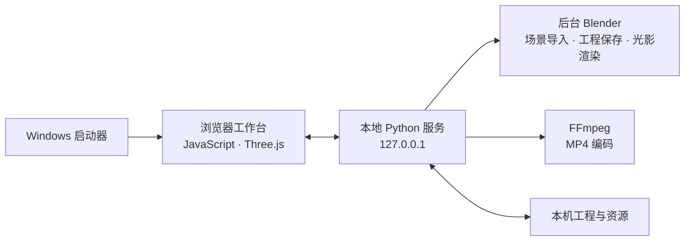
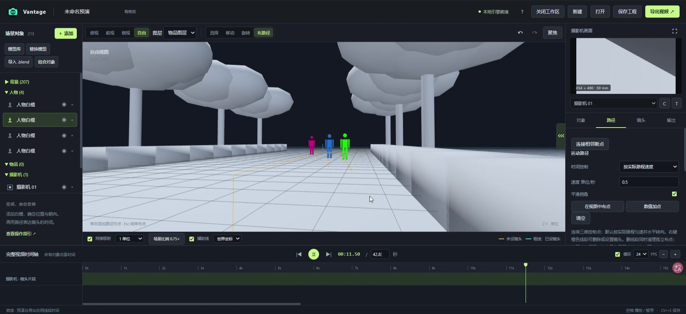
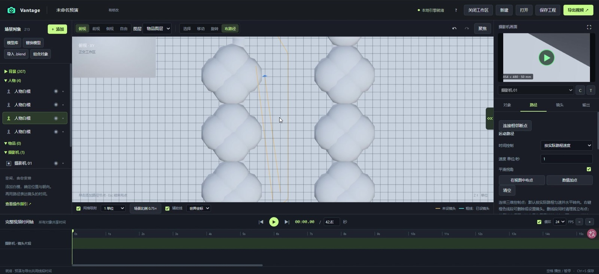
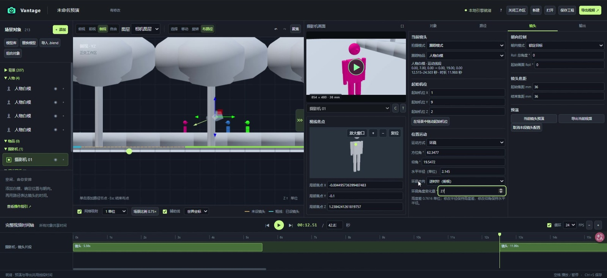
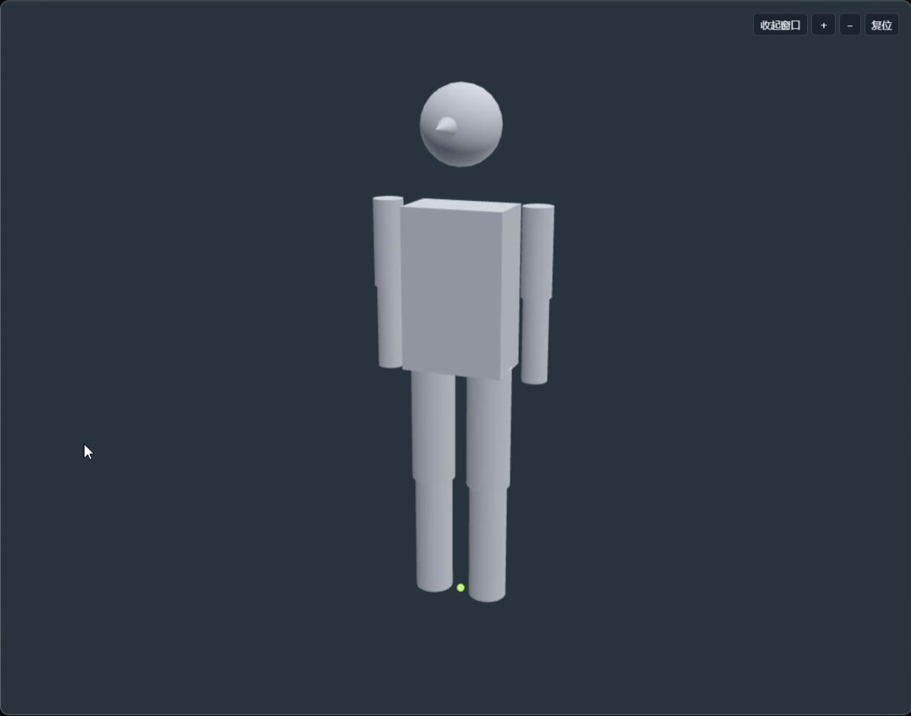
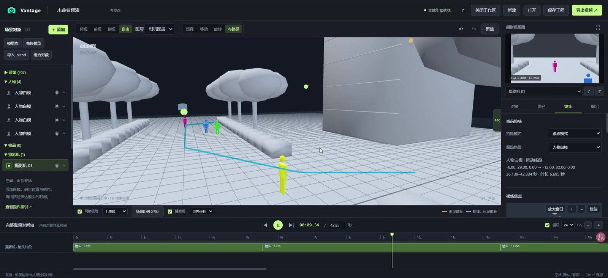
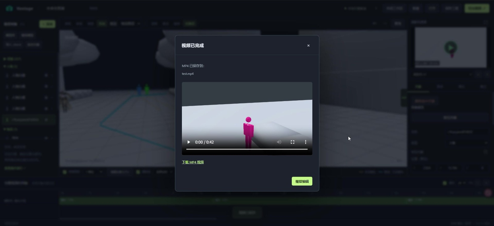

# Vantage

**把走位、构图和镜头运动，变成可以观看、调整和导出的三维预演。**

[下载安装包](https://github.com/Diablosda/Vantage/releases/tag/v2.1.2) · [宣传视频](#宣传视频) · [使用流程与功能](#使用流程与功能) · [详细操作说明](产品说明.md)

## Vantage 是什么

Vantage 是一款在 Windows 本机运行的三维镜头预演工具，适合短片、分镜和 AI 视频创作前期的机位与运镜规划。导入场景后，可以快速放置人物和几何体、绘制运动路径，为每段路径配置独立镜头，再通过实时预览检查构图、走位、运镜与节奏。

它解决的是“文字能描述镜头，但难以准确验证画面”的问题：用可编辑的三维空间和参数，把平移、推拉、环绕等想法具体化，减少正式制作前对位置、方向和时间的反复猜测。预演视频也可用作后续制作的构图与运动参考。Vantage 不负责生成 AI 写实视频，也不自动完成构图或避障。

### 架构

Vantage 采用 **Windows 启动器 + 浏览器工作台 + 本地后台引擎** 的架构。运行时无需云端账号，场景编辑、资源处理与视频编码均在本机完成。

前端负责三维交互、摄影机预览和预览画面采集；本地服务负责资源、工程与任务调度，调用 Blender 和 FFmpeg 完成处理。前后端分别实现对应的路径与镜头求值逻辑，并通过对照测试核对。Windows 原生窗口组件提供保存位置选择。

## 宣传视频

约 44 秒，展示推拉、环绕、模型与路径编辑、参数控制以及保存导出。

https://github.com/user-attachments/assets/3e505bb6-6474-4a8e-bfb9-e03036ed7c4c

## 使用流程与功能

截图取自实际操作录像，仅裁去浏览器栏或无关区域。功能以当前版本为准，完整细节见[产品说明](产品说明.md)。

### 1. 导入场景，建立人物和物品

新建项目后导入 `.blend` 场景，设置单位换算比例；带动画的场景可选择一帧作为静态快照。也可直接添加人物白模、立方体、长方体、球体、圆柱体、圆锥体，填写尺寸、设置定位颜色，快速搭出走位与构图所需的空间关系。

- **外部模型**：模型库支持 GLB、资源内嵌的 glTF，以及包含 glTF 和外部资源的 ZIP；保留可识别的材质、贴图、顶点颜色和骨架。替换模型可保留对象身份、路径及运动配置；提供正面校准和代理白模。
- **整理与摆放**：对象按背景、人物、物品、摄影机和视线目标分组；支持组合对象、复制、隐藏、锁定、删除，编辑位置、旋转与可用的缩放参数。可用变换轴、数值或方向键移动，切换世界/本地坐标。
- **空间辅助**：俯视、前视、侧视和自由视图，网格吸附与自定义步长、场景比例调整、聚焦、撤销和重做。自建人物或几何体可右键“接触地面”，将底部对齐场景地面基准；不执行斜坡、楼梯或任意表面的碰撞吸附。

### 2. 给模型设置路径与动作

选择人物或物品，在正交视图布点或数值加点，建立连续三维路径。可编辑节点位置、到达时间、停留时间、速度缓动、圆角范围及是否精确经过某点；支持插点、删点、删线段、连接相邻断点和清空当前路径。

时间既可按控制点设置，也可按实际路程速度计算。对象可固定朝向、沿路径转向或使用手动关键角度；人物支持地面运动锁定 Z。带路径的对象可整体平移，保留轨迹形状与时间。需要人物动作时，可为不同线段绑定兼容骨架的 GLB 动作；动作素材需自行提供。

### 3. 为每段路径配置独立镜头

右键运动线段或停留点设置镜头。每段的起始机位、焦点、运动、朝向与焦距独立保存；可复制上一镜结束状态与配置作为起点，之后修改不会联动改变另一段。所有对象共享场景时间，切镜时人物运动不会从头开始。可添加摄影机并切换当前活动摄影机。

| 控制内容 | 可配置的行为 |
| --- | --- |
| 拍摄模式 | 跟踪有有效路径的目标，或使用自由镜头；自由镜头可编辑相机路径和角度、焦距关键帧。 |
| 起始机位 | 输入世界 XYZ 坐标，或在场景中拖动摄影机 C；视线目标 T 辅助构图与跟随。 |
| 平移 | 沿世界 X/Y/Z 单轴移动，或用三个轴的有符号速度组合斜向运动。 |
| 推进与拉远 | 沿本段开始时的三维视线推进或后退，配置方向和速度。 |
| 环绕 | 设置方位角、仰角、水平半径、顺/逆时针方向和环绕角度；当前新镜头保持水平半径及相对高度，跟踪时圆心随焦点移动。 |
| 朝向 | 锁定目标，或保持自由朝向并叠加 Pan、Tilt、Roll 总角度；锁定目标时 Pan/Tilt 不参与求值，Roll 仍可叠加。 |
| 焦距 | 设置起始与结束焦距（mm），控制一段中的取景变化；适用模式下也可使用焦距关键帧及插值。 |
| 焦点 | 设置目标局部坐标或世界辅助视点；跟踪目标时可在模型表面选点。焦点用于视线与跟踪，不等同于景深模拟。 |

“视线焦点”支持放大窗口、滚轮或按钮缩放、旋转、平移，以及点击或拖动模型表面选点。复位只恢复观察视角，已选焦点保留。

### 4. 实时预演，检查镜头与节奏

右上摄影机小窗实时显示取景，支持全屏查看；可预演当前镜头，或播放完整时间轴。支持拖动时间游标、循环、调整帧率和时间轴缩放。底部仅展示摄影机镜头片段轨道，时间刻度仍对应原场景时间。

已设置镜头的路径显示为**青色粗线**，未设置的显示为橙色细线；当前选中段为绿色高亮，路径列表同步标注“已设镜头”。可直接对照场景中的机位、人物运动和摄影机画面。

### 5. 导出当前镜头或整片视频

- 顶部 **“导出视频”**：按场景时间顺序拼接全部已配置镜头的片段，跳过未配置镜头的间隔与尾部。
- 右侧 **“导出当前视频”**：只导出当前选中路径片段配置的镜头；没有镜头配置时提示先设置。
- 可设置画面宽高和帧率。默认关闭光影渲染，使用摄影机小窗的同一渲染器采集画面，保留模型材质与定位颜色；开启后使用 Blender 光照渲染。MP4 压缩会带来细微像素差异。
- 通过“另存为”选择 MP4 文件的位置与名称。导出目录只得到视频，不附带帧图片、模型或工程压缩包；辅助线不进入画面。预览采集期间需保持页面打开，可取消任务。

### 6. 保存、加载与迁移工程

“保存工程”创建可编辑的 `.previs`、Blender `.blend` 和包含引用资源的 `.previs.zip` 完整工程包；保存位置可选择，每次保存建立新工程文件夹。可从启动页或顶部“打开”加载已有工程，跨电脑迁移优先使用完整工程包。浏览器草稿用于临时恢复，不能代替正式保存；导出视频也不会代替保存工程。

常用快捷键：空格播放/暂停，Q/W/E 切换选择/移动/旋转，F 聚焦，Ctrl+Z 撤销，Ctrl+Shift+Z 重做，Ctrl+S 保存。

## 安装与运行

### Windows 用户

1. 打开 [v2.1.2 下载页](https://github.com/Diablosda/Vantage/releases/tag/v2.1.2)，下载 **`Vantage-2.1.2-Setup.exe`**；源码归档和第三方源码附件无需下载。
2. 运行安装向导，选择安装位置。默认安装到当前用户目录，无需管理员权限。
3. 从桌面或开始菜单启动 **Vantage**。界面在本机浏览器中打开，新建或加载项目即可使用。

安装包已内置 Blender 5.2.2、其 Python、FFmpeg 7.1 和前端文件，**无需另装 Python、Node.js、Blender 或 FFmpeg**。需要 Windows x64、支持 WebGL 的浏览器，以及满足内置 Blender 要求的显卡与驱动。当前安装包为未数字签名的预发布版。

程序与用户数据分开存放：资源和默认工程在 `%LOCALAPPDATA%/Vantage/Data`，缓存位于 `%LOCALAPPDATA%/Vantage/Cache` 及系统临时目录；用户主动选择的工程和视频保存在所选位置。卸载保留用户数据。旧目录资源只读兼容；换安装位置时，使用完整工程包迁移。

### 源码运行与构建

Git 仓库包含应用源码、启动器和前端资源，**不包含大体积 Blender/FFmpeg 运行组件**。仅拉取仓库不会自动装好这些组件。开发者可将干净组件放入 `runtime/blender`、`runtime/ffmpeg`，或设置 `PREVIS_BLENDER`、`PREVIS_FFMPEG` 指向可执行文件，再运行 `Vantage.exe` 或 `Vantage.cmd`；也可用 Python 执行 `python -B server.py --open`。

开发与安装包构建命令

- `launcher/build.cmd`：重建 Windows 启动器与原生保存窗口。
- `python build.py`：生成应用源码包。
- `node --test tests/*.test.mjs`、`python -B -m unittest discover -s tests -p "test*.py"`：自动测试；浏览器集成测试另需 Playwright 和浏览器。
- 按 `packaging/components.json` 下载并校验组件，干净解压到工作目录后运行 `python packaging/build_installer.py --work <工作目录>`，使用其中的 NSIS 构建离线安装包。
- `VANTAGE_DATA_DIR`、`VANTAGE_CACHE_DIR` 可覆盖默认数据与缓存位置。

### 兼容性与验证范围

场景导入生成静态几何快照，不保证完整保留父子关系、修改器、动画或全部材质节点；集合实例需先实体化，外部贴图应在 Blender 内打包。模型与动作兼容性取决于素材。完整工程包上限 512 MB、单资源上限 128 MB、场景可见网格快照合计上限 40 万顶点。

v2.1.2 已通过 62 项前端与 59 项 Python 测试，以及同机隔离安装、保存、导出与卸载测试；尚未完成全新 Windows 环境和原生保存窗口的人工点击验收。更多限制见[产品说明](产品说明.md)。第三方组件许可及对应源码见 [THIRD_PARTY.md](THIRD_PARTY.md)；Vantage 自身尚未单独指定开源许可证。
